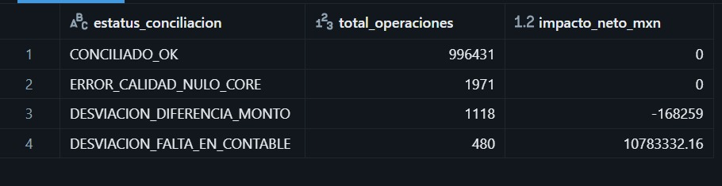
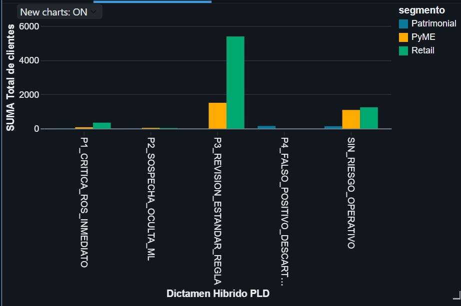
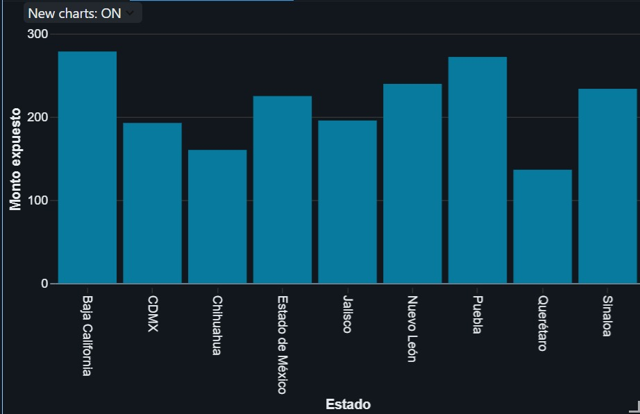

# 🛡️ Motor Distribuido de Monitoreo Transaccional PLD/FT y Detección de Anomalías (PySpark + Delta Lake + ML)


-red)


## 📋 Resumen Ejecutivo

Este proyecto implementa una arquitectura de **Prevención de Lavado de Dinero y Financiamiento al Terrorismo (PLD/FT)** diseñada para operar sobre volúmenes masivos de transacciones bancarias en México (**1,000,000 de operaciones** y **10,000 clientes**) utilizando **Apache Spark (PySpark / Spark SQL)** y **Delta Lake** en **Databricks**.

El sistema resuelve el ciclo completo de cumplimiento analítico y gobierno de datos:
1. **Auditoría de Calidad y Conciliación Contable:** Validación automatizada entre el *Core Transaccional* y el *Sistema Contable* para garantizar integridad, completitud y trazabilidad antes del modelado.
2. **Motor de Reglas Regulatorias (CNBV / UIF / GAFI):** Procesamiento de ventanas móviles temporales (`Window Functions`) para detectar fraccionamiento de efectivo (*Smurfing*), inusualidad contra perfil declarado y transferencias a jurisdicciones de alto riesgo.
3. **Detección de Anomalías No Supervisada y Reducción de Falsos Positivos:** Combinación de **Isolation Forest** y **K-Means** para identificar tipologías ocultas que evaden umbrales fijos y filtrar ruido operativo.

---

## 🏗️ Arquitectura del Pipeline

```text
[1. Ingesta & Gobierno de Datos] ──► Core (1M Tx) vs Contabilidad -> Auditoría de Integridad y Conciliación
               │
               ▼
[2. Motor Reglas PLD (PySpark)] ───► Window Functions (24h / 7d) -> Tipologías CNBV, UIF y GAFI
               │
               ▼
[3. ML No Supervisado (Sklearn)] ──► Isolation Forest + K-Means -> Matriz Híbrida (P1 - P4) y Filtro de FP
               │
               ▼
[4. Analítica SQL & Reporting] ────► Vistas Ejecutivas, Exposición Geográfica y Expedientes ROS
```

---

## 🔍 Desglose Técnico por Módulo

### 1. Calidad de Datos y Conciliación (`01_Ingesta_y_Conciliacion_PLD.py`)
* Ejecución de cruces `FULL OUTER JOIN` entre fuentes transaccionales y contables para aislar operaciones huérfanas, desviaciones de monto y valores nulos (`ERROR_CALIDAD_NULO_CORE`, `DESVIACION_FALTA_EN_CONTABLE`, `DESVIACION_DIFERENCIA_MONTO`).
* Persistencia en tablas **Delta Lake** (`bbva_pld_db`) asegurando linaje de información y reproducibilidad.



### 2. Reglas Determinísticas PLD con Window Functions (`02_Motor_Reglas_PLD_CNBV.py`)
Cálculo distribuido de agregaciones móviles por cliente (`Window.partitionBy("id_cliente").orderBy("ts_unix").rangeBetween(...)`) para evaluar cuatro tipologías regulatorias calibradas:
* **`R1_PITUFEO_ESTRUCTURACION_CNBV`:** 3 o más depósitos en efectivo en 7 días justo debajo del umbral relevante (`$135K–$148K MXN`) con acumulación $\ge \$400K\text{ MXN}$.
* **`R2_INUSUALIDAD_PERFIL_UIF`:** Operaciones que exceden $\ge 12\times$ el ingreso mensual declarado del cliente.
* **`R3_JURISDICCION_ALTO_RIESGO_GAFI`:** Transferencias `SWIFT` internacionales relevantes hacia jurisdicciones de vigilancia reforzada (`PANAMA`, `ISLAS_CAIMAN`).
* **`R4_VELOCIDAD_NOCTURNA`:** Ráfagas de $\ge 8$ transacciones en ventana de 24 horas ejecutadas en horario de madrugada (`01:00–04:59`).

### 3. Machine Learning No Supervisado y Matriz Híbrida (`03_ML_Anomalias_Clustering_PLD.py`)
Escalamiento robusto (`RobustScaler`) resistente a valores extremos financieros y entrenamiento de **Isolation Forest** + **K-Means** para clasificar la cartera en niveles accionables:

| Dictamen Híbrido | Clientes | Score Anomalía Prom. | Volumen Mensual (MXN) | Acción Operativa |
| :--- | :---: | :---: | :---: | :--- |
| **`P1_CRITICA_ROS_INMEDIATO`** | **430** | `65.70` | `$1,768.19M` | Confirmado por Regla CNBV + ML. Dictamen prioritario para UIF. |
| **`P2_SOSPECHA_OCULTA_ML`** | **70** | `63.48` | `$165.64M` | **Evadió reglas fijas**, detectado exclusivamente por `Isolation Forest`. |
| **`P3_REVISION_ESTANDAR_REGLA`** | **6,891** | `24.41` | `$17,916.55M` | Seguimiento ordinario por alerta determinística aislada. |
| **`P4_FALSO_POSITIVO_DESCARTADO`** | **148** | `27.79` | `$380.02M` | Ruido operativo filtrado por perfil Patrimonial normal. |
| **`SIN_RIESGO_OPERATIVO`** | **2,461** | `26.00` | `$4,692.38M` | Operación cotidiana sin hallazgos. |

### 4. Analítica Ejecutiva en Spark SQL (`04_Analitica_SQL_y_Dashboard_PLD.sql`)
Consultas analíticas para monitoreo de exposición por segmento bancario, concentración geográfica y generación de expedientes priorizados para Oficiales de Cumplimiento.




---

## 📁 Estructura y Gobierno de Datos

* [`docs/diccionario_datos_y_linaje.md`](doc/diccionario_datos_y_linaje.md): Linaje completo de tablas Delta Lake, tipos de datos, dominios y reglas de validación.
* [`script/`](script/): Pipelines modulares en PySpark y scikit-learn.
* [`sql/`](sql/): Vistas analíticas en Spark SQL.
